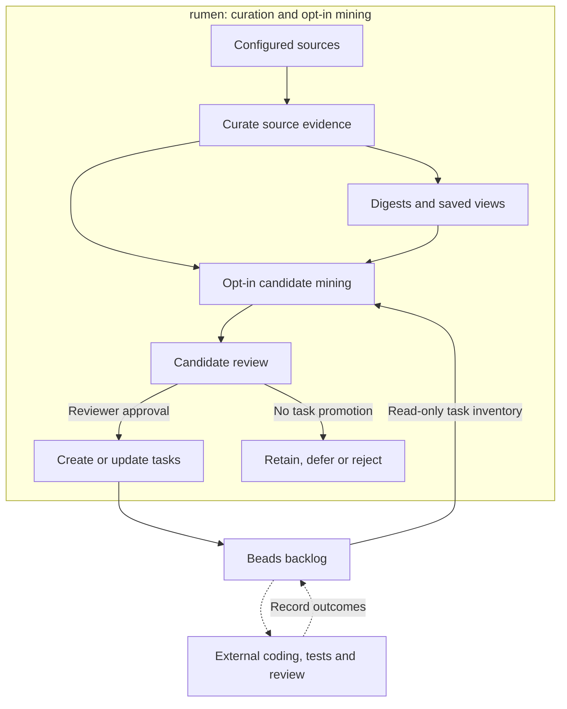

# rumen


Self-contained knowledge-curation and backlog-mining engine. Turn content feeds
into ranked digests, then use that evidence to draft and curate enhancement work
for your repositories. Explicit reviewer approval can promote proposals into
[Beads](https://github.com/steveyegge/beads) tasks.

rumen provides the knowledge-to-backlog layer of a self-improving repository
workflow. It owns its SQLAlchemy storage and runs with SQLite or Postgres;
implementation, testing and code review remain with your development workflow.

## Contents

- [What it does](#what-it-does)
- [From digests to enhancement tasks](#from-digests-to-enhancement-tasks)
- [Roadmap](#roadmap)
- [Prerequisites](#prerequisites)
- [Installation](#installation)
- [Quick start: SQLite](#quick-start-sqlite)
- [Configuration, databases, and adapters](#configuration-databases-and-adapters)
- [Adapters](#adapters)
- [CLI](#cli)
- [Project layout](#project-layout)
- [Tests](#tests)
- [Configuration reference](docs/configuration.md)
- [Environment reference](docs/environment.md)
- [Extending rumen](docs/extending.md)
- [Data model](docs/data-model.md)
- [Limitations](#limitations)
- [Security](#security)
- [Contributing](#contributing)
- [Provenance](#provenance)
- [License](#license)

## What it does

rumen processes configured sources through one pipeline:

1. ingest content from source adapters;
2. classify it and apply keyword tags;
3. group items by stable identity and near-duplicate relationships;
4. rank the resulting topic entities;
5. produce periodic digests; and
6. optionally mine that knowledge for evidence-backed enhancement proposals,
   curate them against the existing backlog, and promote explicitly approved work.

The engine includes adapters and configuration templates for browser bookmarks,
GitHub, Hacker News, Hugging Face Daily Papers, npm, Reddit, RSS/Atom, YouTube,
and local cache-based sources. Sources are opt-in: the shipped example config has
none enabled.

The current interfaces are the CLI and Python APIs, including
[tool functions](src/rumen/mcp_tools.py) that an external MCP host can expose.
A web dashboard and an MCP host are not bundled.

## From digests to enhancement tasks

Use rumen to turn relevant releases, research, tools and techniques into proposed
improvements to a repository, harness or workflow, including rumen itself. Mining
combines ranked source evidence and available digest context with a configured
target and task template. Relevance alone is not enough: the actionability judge
must support a concrete proposal with evidence, or abstain.

The implemented [backlog-mining subsystem](src/rumen/backlog_mining/__init__.py) supports:

| Capability | What it provides |
| --- | --- |
| Evidence-backed drafts | Source excerpts, URLs, digest context and recorded target/template identities, with structured validation and a separately executed evaluator before admission. |
| Backlog curation | Freshness and duplicate gates, read-only open and closed task inventory, evidence accumulation for existing candidates, and explicit review of closed-task matches. |
| Review and revision | Candidate lifecycle APIs for acceptance, edits, merging, deferral, rejection and knowledge-only retention; append-only disposition history and reversible candidate-state changes. |
| Connected evidence | Source claims, configured context and model inferences shown separately, plus candidate-attributed evidence across proposals about the same topic entity. |
| Explicit task promotion | CLI actions to create a task, relate new work to an existing task, group work under a shared epic, update selected work or change its status, with task links and operation receipts. |

This supports a **self-improving repository feedback loop**: curate knowledge,
propose enhancements, review and prioritize the work, implement it through your
chosen human or coding-agent workflow, then let later mining consider the updated
task inventory and newly ingested evidence. The engine supplies the evidence,
review history and task handoff; it does not autonomously modify, test or merge
repository code.

Solid arrows below are implemented engine and task-store interactions. Dashed
arrows are external development steps, not an autonomous execution service bundled
with rumen.



Mining and accepting a candidate do not by themselves write to Beads. Only an
explicit promotion action crosses that boundary. A task classified as implemented
keeps its content and completion status; further work must be a new task, which
may be explicitly related or grouped under a shared epic. A disabled-by-default
session projection can also return an approved
task plan, but execution belongs to the invoking session.

Post-pipeline mining is disabled by default (`backlog_mining_enabled: false`);
`rumen backlog mine` is the explicit standalone entry point. Configure eligible
sources, target/template mappings, a trusted actionability command and access to
the intended Beads repository through `bd`. The bundled reader and promoter use
that external CLI; a task-store identity is not automatic directory or remote-store
routing. Unavailable or unsupported judging abstains, and mining failures are
recorded separately without undoing completed curation. See the
[backlog settings](docs/configuration.md#optional-backlog-controls),
[review API](src/rumen/backlog_mining/review.py) and
[promotion boundary](src/rumen/backlog_mining/promotion.py).

## Roadmap

This is a loose view of current capabilities and proposed directions, not release
commitments or dates. Priorities may change as curation and candidate quality are
evaluated.

| Horizon | Focus | Scope |
| --- | --- | --- |
| Current | Core curation | Opt-in adapters, faceted classification, cross-source deduplication, personalized ranking, and periodic digests, with SQLite/Postgres storage, saved views, ratings, and classification corrections. |
| Current | Digest-to-backlog feedback | Evidence-backed candidate mining, existing-task checks, backlog review and revision, cross-candidate evidence, and explicit Beads promotion. Coding and deployment remain outside the engine. |
| Next (proposed) | Browsing and review | A web interface for saved views, digest reading, candidate/backlog review and feedback, plus interactive duplicate review built on the existing filtering, correction, merge and unmerge APIs. |
| Next (proposed) | Metadata sources | Opt-in security-advisory and scholarly-metadata adapters with stable identifiers, incremental updates, and documented access and reuse requirements. |
| Later (exploratory) | Broader improvement-loop integrations | More convenient development-workflow handoffs and outcome feedback, evaluated against explicit quality and approval boundaries rather than assumed autonomous code changes. |
| Later (exploratory) | Adaptive relevance | Multiple interest profiles and diagnostics for profile drift and digest diversity; evaluate feedback-driven classifier and deduplication tuning against explicit quality checks. |

## Prerequisites

- Python 3.11 or later
- [uv](https://docs.astral.sh/uv/) (required)
- A SQLite file for a local trial, or a reachable Postgres database

## Installation

Clone the repository once, then install with uv. These commands
use a POSIX shell; on Windows use the virtual environment's activation command.

```bash
git clone https://github.com/sergeiwallace/rumen.git
cd rumen
```

```bash
uv sync --locked
source .venv/bin/activate
rumen --help
```

`uv sync --locked` creates `.venv` and installs the checkout in editable mode. Use
`uv sync --locked --no-editable` for a regular installation from the checkout.
Install only the optional features you need. For the development checks, taxonomy
APIs, RSS and Reddit support:

```bash
uv sync --locked --extra dev --extra taxonomy --extra feeds --extra reddit
```

`uv sync` makes the environment match the extras named, so name all wanted extras
in one command.

| Extra | Enables |
| --- | --- |
| `dev` | pytest, pytest-xdist and pinned Ruff checks |
| `taxonomy` | RDF/SKOS loading, validation and materialization with rdflib and skosify |
| `feeds` | RSS/Atom adapter parsing with feedparser |
| `reddit` | Subreddit API adapter with PRAW; saved-items cache reading needs no extra |
| `embeddings` | SentenceTransformer semantic embeddings; heavy model dependencies and first-use model download |
| `hmc-fit` | Optional cleanlab quality checks for hierarchical classifier fitting |
| `local-llm` | Empty discoverability extra; install and configure the external Ollama runtime separately |
| `youtube-transcripts` | Opt-in unofficial caption enrichment; official playlist discovery needs no extra |

Weak-supervision bootstrap is deferred from this release because Snorkel has
unresolved security advisories with no fixed release. It is neither declared nor
loaded, even if installed separately. Its former API entry points raise a clear
unavailable-feature error. Use curated labels or the independent
`rumen.taxonomy.bootstrap.llm_teacher.run_teacher_pass` API instead. Restoration
requires a fixed dependency and a fresh security review.

Taxonomy imports accept local files, inline RDF, and JSON-LD with embedded
contexts. URL sources and remote JSON-LD contexts (including `@import`) are
refused before network access. Download documents separately and embed their
contexts before importing.

## Quick start: SQLite

After installation, run this from the repository root with its
virtual environment active. It creates an explicit local database and runs with
no sources. CLI startup applies migrations. No credentials or LLM are needed.

```bash
export RUMEN_DB_DSN='sqlite:///rumen.db'
cp config.example.json config.local.json
rumen run --config config.local.json
rumen feed status
rumen feed items --source rss_atom:example --limit 20
rumen digest --config config.local.json
rumen feed digest
```

An empty source list produces no ingestion rows or digest content. Add a source
using the [tested template merge](docs/configuration.md), replace
its placeholders and run again. Rumen never chooses SQLite implicitly. Set
`RUMEN_DB_DSN` or `database.dsn`; the environment takes precedence.

## Configuration, databases, and adapters

[Configuration](docs/configuration.md) lists every loader setting, default,
validation rule and template-merge procedure. [Environment](docs/environment.md)
covers credentials, database connection controls, logging and `AI_HOST` routing.
Templates are JSON fragments with source entries, not files to copy verbatim over
your whole config. Credentials are supplied through named environment variables.

For Postgres, set `RUMEN_DB_DSN` to your connection URL, optionally set
`RUMEN_DB_SCHEMA` for schema isolation, then use the same CLI commands. Only the
SQLAlchemy storage backend is supported. An unreachable database raises an error;
it does not fall back to SQLite.

## Adapters

Every source is opt-in. Cache readers require existing compatible upstream data;
they do not synchronize those services themselves. The two disabled templates
need additional settings before enabling. See [source settings](docs/configuration.md).

| Source type | Input | Template | Extra |
| --- | --- | --- | --- |
| `bookmarks` | Local bookmark cache | [bookmarks](config/templates/bookmarks.json) | Base |
| `chrome_bookmarks` | Local browser bookmarks JSON | [chrome_bookmarks](config/templates/chrome_bookmarks.json) | Base |
| `chrome_reading_list` | Local connector snapshot; disabled template | [chrome_reading_list](config/templates/chrome_reading_list.json) | Base; browser connector not bundled |
| `github_releases` | Repository release Atom feed | [github_releases](config/templates/github_releases.json) | Base |
| `github_repository` | Repository metadata API | [github_repository](config/templates/github_repository.json) | Base |
| `github_stars` | Authenticated user's stars | [github_stars](config/templates/github_stars.json) | Base |
| `github_stars_list` | Named star list | [github_stars_list](config/templates/github_stars_list.json) | Base |
| `hacker_news` | Search queries | [hacker_news](config/templates/hacker_news.json) | Base |
| `hf_daily_papers` | Daily paper listings | [hf_daily_papers](config/templates/hf_daily_papers.json) | Base |
| `npm_registry` | Package registry releases | [npm_registry](config/templates/npm_registry.json) | Base |
| `paperpile` | Existing local library cache | [paperpile](config/templates/paperpile.json) | Base |
| `reddit_saved` | Existing saved-items cache | [reddit_saved](config/templates/reddit_saved.json) | Base |
| `reddit_subreddits` | Subreddit API; disabled template | [reddit_subreddits](config/templates/reddit_subreddits.json) | `reddit` |
| `rss_atom` | Public HTTPS RSS/Atom feed | [rss_atom](config/templates/rss_atom.json) | `feeds` |
| `spotify_podcasts` | Existing local podcast cache | [spotify_podcasts](config/templates/spotify_podcasts.json) | Base |
| `youtube_playlist` | Official playlist API | [youtube_playlist](config/templates/youtube_playlist.json) | Base; `youtube-transcripts` for optional captions |

## CLI

`rumen --help` lists commands; each command accepts `--help`. The main public
operations are `run` (ingest through ranking), `digest` (generate), and `feed`
(`items`, `status`, `digest`, `rate`). `classify review` records human facet
assignments and `classify metrics` shows telemetry. `fit-classifier` fits bundles;
`taxonomy-audit` runs taxonomy maintenance. `reddit purge` is an explicit,
confirmed deletion operation.

`backlog mine` generates candidate drafts; `backlog list` and `backlog show` expose
the queue and evidence; `backlog review` records an attributed reviewer action.
Its explicit `--promote-as` options (`new`, `related`, `shared-epic`, `update`,
`status`) can write to Beads through `bd`. These are not implied by mining or
acceptance. Use `rumen backlog review --help` for the required actor, rationale,
task selection and operation-specific safeguards. The Python APIs also expose
candidate-family revision and undo/redo controls.

`run --digest` generates a digest after processing; `--digest-period-days` selects
the window. `digest --period-start` and `--period-end` accept explicit boundaries;
`--force` permits regeneration. The default digest is extractive. `--abstractive`
requires a configured LLM command; `--local-polish` uses a matching local model.
See [LLM configuration](docs/configuration.md) and the
[extension contracts](docs/extending.md).

When `backlog_mining_enabled` is true, `run` uses the combined refresh path:
curation, optional digest generation, then candidate mining. Scheduling and
operational notification delivery are integration choices; the job APIs expose
separate mining results and alert status.

## Project layout

| Path | Contents |
| --- | --- |
| [src/rumen/cli.py](src/rumen/cli.py) | CLI entry point |
| [src/rumen/config.py](src/rumen/config.py) | JSON loader and adapter builder |
| [src/rumen/adapters/base.py](src/rumen/adapters/base.py) | Normalized items and adapter protocols |
| [src/rumen/jobs.py](src/rumen/jobs.py) | Pipeline orchestration |
| [src/rumen/backlog_mining/](src/rumen/backlog_mining/__init__.py) | Candidate mining, evidence, review history, read-only task inventory, explicit promotion and session-plan projection |
| [src/rumen/models.py](src/rumen/models.py) | SQLAlchemy tables; see [data model](docs/data-model.md) |
| [src/rumen/db/migrate.py](src/rumen/db/migrate.py) | Alembic migration runner; revisions live alongside it |
| [src/rumen/embeddings.py](src/rumen/embeddings.py) | Embedding provider seam |
| [src/rumen/llm.py](src/rumen/llm.py) | Subprocess LLM seam |
| [config.example.json](config.example.json) | Minimal configuration; adapter templates are listed above |
| [tests/feed/test_ingest.py](tests/feed/test_ingest.py) | Ingestion tests; other tests cover feed, taxonomy and backlog behavior |
| [pyproject.toml](pyproject.toml) | Dependencies, extras and tool settings |

## Tests

Install the development extras shown above, then run from the repository root:

```bash
pytest tests/feed/test_ingest.py tests/test_config_templates.py
ruff check src/ tests/ && ruff format --check src/ tests/ && pytest
```

The second line is the hard gate. Postgres tests skip without
`RUMEN_TEST_PG_DSN`. Real-model embedding tests are opt-in; heavier extras have
separate optional tests. See [CONTRIBUTING.md](CONTRIBUTING.md) for contribution
expectations and [environment](docs/environment.md) for test controls.

## Limitations

- No source is enabled by default; you must configure and authorize each source.
- Optional adapters require their corresponding extras, such as `.[feeds]` for
  RSS/Atom and `.[reddit]` for Reddit.
- The default digest is extractive. Abstractive digest generation requires an
  explicitly configured local LLM command.
- SQLite is suitable for local use; use Postgres for shared or production
  deployments.
- Backlog mining is opt-in and requires target/template configuration, usable
  evidence and task inventory, and a configured actionability backend. The built-in
  task-store integration requires `bd` and the intended repository context.
- There is no bundled autonomous coding, testing or merging loop. External
  development workflows execute approved tasks; session projection returns a plan,
  not a running agent or a completed change.

## Security

Please do not report vulnerabilities in public issues. Follow the private
reporting process in [SECURITY.md](SECURITY.md).

## Contributing

Contributions are welcome. See [CONTRIBUTING.md](CONTRIBUTING.md)
for setup, tests, pull-request expectations, and the public/private boundary.

## Provenance

The public repository history begins at a clean root commit. The release policy is
that private pre-launch history will not be published.

## License

rumen is licensed under the [MIT License](LICENSE).
